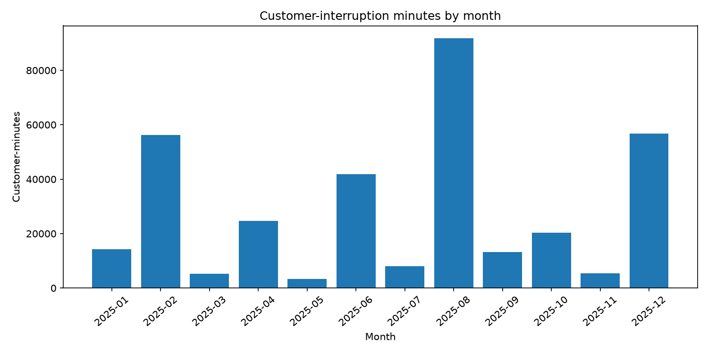
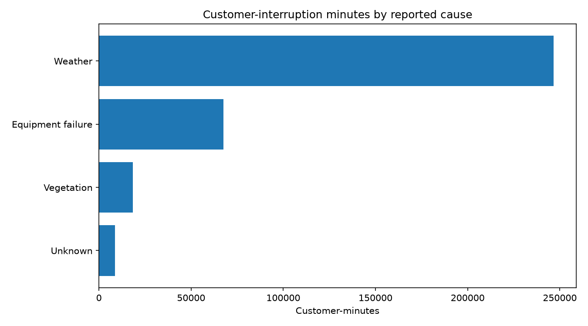

# Electrical Grid Reliability Analyzer

A Python-based project that analyzes simulated electrical outage data to evaluate the reliability of an electrical distribution system.

## Project Overview

Electrical utilities need to monitor power outages to understand how frequently customers lose electricity and how long interruptions last.

This project processes outage records, calculates standard reliability metrics, and generates visualizations to identify outage trends.

The project uses fictional outage data for educational purposes. It does not represent actual Con Edison operations.

## Features

- Reads electrical outage records from a CSV file.
- Calculates SAIFI, SAIDI, and CAIDI.
- Generates graphs of customer-interruption minutes by month and reported outage cause.
- Checks for missing or invalid data, including negative values and invalid dates.
- Detects duplicate event IDs.
- Rejects outages affecting more customers than the system serves.
- Exports reliability metrics to a CSV file.

## Reliability Metrics

**SAIFI (System Average Interruption Frequency Index)**

Average number of sustained customer interruptions per customer.

SAIFI = Total customer interruptions / Total customers served

**SAIDI (System Average Interruption Duration Index)**

Average total interruption duration per customer.

SAIDI = Total customer-interruption minutes / Total customers served

**CAIDI (Customer Average Interruption Duration Index)**

Average duration of a customer interruption.

CAIDI = SAIDI / SAIFI

## Technologies Used

- Python
- Matplotlib
- CSV
- argparse

## How to Run

1. Install Python 3.10 or newer.
2. Download or clone this repository.
3. Open the project folder in a terminal.
4. Install dependencies:

   python -m pip install -r requirements.txt

5. Run the analyzer:

   python analyzer.py

Generated charts and the reliability summary are saved in the `output` folder.

## Example Results

Using the included fictional dataset containing 12 outage events and 10,000 customers:

| Metric | Result |
|---|---|
| SAIFI | 0.3190 interruptions/customer |
| SAIDI | 34.12 minutes/customer |
| CAIDI | 106.97 minutes/interruption |

## Visualizations

### Monthly Outage Impact

### Outage Impact by Cause

## Limitations

- The included dataset is fictional.
- The analysis assumes each outage record represents a distinct sustained customer interruption event.
- Duplicate event IDs are rejected, but separate IDs do not guarantee that events are unrelated.
- The program does not independently verify outage causes or predict future outages.
- Real utility reporting may involve additional reliability standards and exclusions.

## Future Improvements

- Analyze publicly available electricity reliability data.
- Add filtering by date, location, and outage cause.
- Develop an interactive dashboard using Streamlit.

## Purpose

This project was developed to practice Python programming, engineering data analysis, and electrical distribution reliability concepts.
